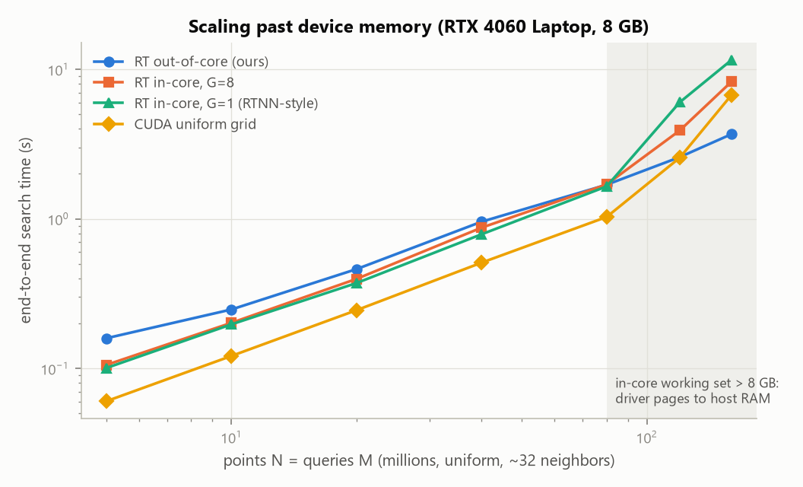
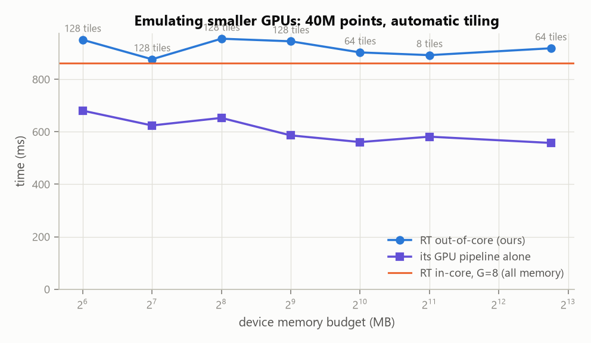
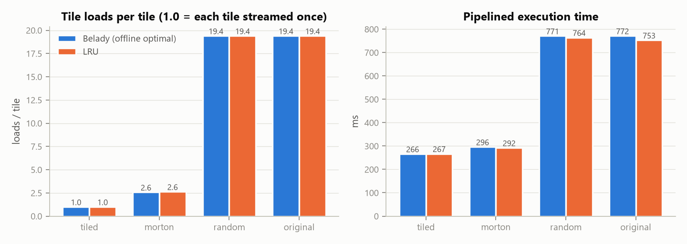
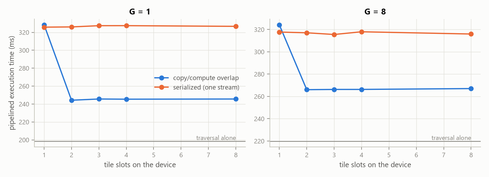
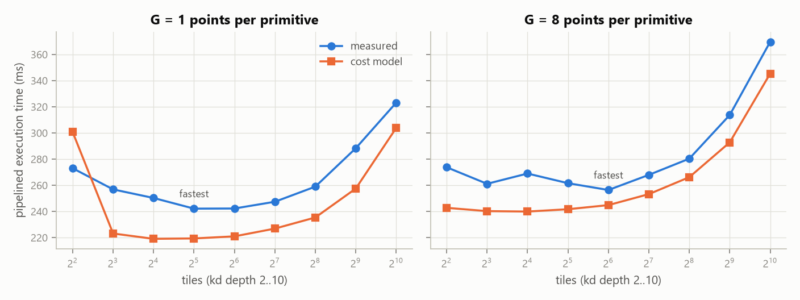
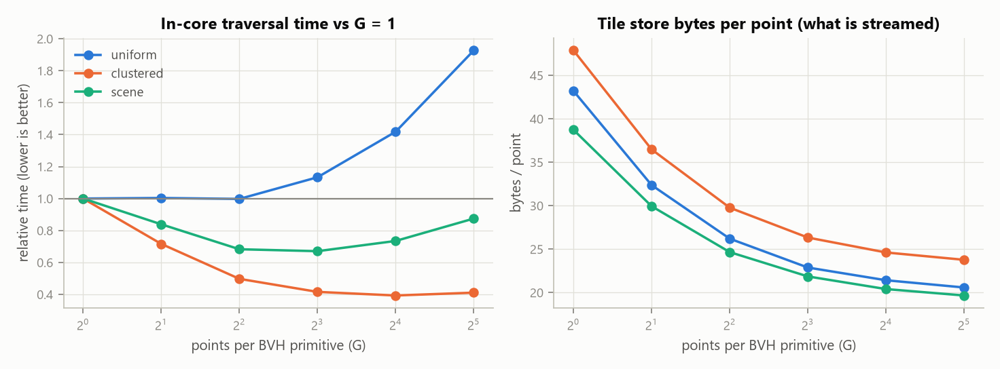

# Out-of-Core RT-Core Fixed-Radius Neighbor Search

**PCAP project, Group 15** — Abyuday Gupta, Aditya Chetan Thakur, Sankalp Arya, Shaurya Jain

GPU ray-tracing (RT) cores accelerate BVH traversal, and RTNN-style methods use
them for neighbor search — but only while the whole acceleration structure fits
in device memory. This repository implements the synopsis' answer: split the
points into spatial **tiles**, keep a **compact, relocatable BVH per tile in
pinned host memory**, **stream** tiles to the GPU with **double buffering**,
**reorder queries** so each loaded tile serves as many queries as possible, and
let a **cost model** pick the tile size. Results are exact and identical to a
CPU reference on every configuration.

## Results (RTX 4060 Laptop GPU, 8 GB)

All 309 benchmark runs returned exactly the CPU reference's answers. Full tables:
[results/summary.md](results/summary.md); method: [docs/EXPERIMENTS.md](docs/EXPERIMENTS.md).

**1. Past device memory, explicit out-of-core streaming beats every in-core method.**
On Windows (WDDM) an in-core working set larger than VRAM does not fail: the
driver pages device memory to host RAM, and the in-core methods slow down
sharply. The out-of-core search used a fixed **1 GB** budget throughout.



| points | RT out-of-core (ours) | RT in-core, G=8 | RT in-core, G=1 (RTNN-style) | CUDA grid |
|---:|---:|---:|---:|---:|
| 40M | 0.96 s | 0.87 s | 0.79 s | 0.51 s |
| 80M | 1.69 s | 1.70 s | 1.65 s | 1.03 s |
| 120M | **2.59 s** | 3.90 s | 6.02 s | 2.56 s |
| 160M | **3.69 s** | 8.29 s | 11.56 s | 6.75 s |

At 160M points the out-of-core search is 2.2× faster than in-core RT, 3.1× faster
than the RTNN-style configuration, and 1.8× faster than the CUDA grid. While
everything fits, it costs 1.0–1.6× the in-core RT time.

**2. Very little device memory is needed.** With automatic tiling, 40M points take
0.95 s with a 64 MB budget (0.8% of the GPU) against 0.86 s in-core with all of it.



**3. Query ordering decides tile reuse.** 20M points, 128 tiles, only 4 tile slots:

| order | tile loads / tile | bytes streamed | GPU pipeline | end-to-end |
|---|---:|---:|---:|---:|
| tile-major + Morton (default) | **1.00** | 0.7 GB | 266 ms | 455 ms |
| global Morton (synopsis) | 2.58 | 1.5 GB | 296 ms | 732 ms |
| original | 19.4 | 8.6 GB | 771 ms | 1033 ms |
| random | 19.4 | 8.6 GB | 771 ms | 1363 ms |

Pipeline-aware Belady eviction needs fewer loads than LRU (2.58 vs 2.63 per tile
for Morton order) at the same speed.



**4. Double buffering hides most of the transfer time.** Overlapping copies with
traversal cuts the pipeline from 326 ms to 244 ms (traversal alone: 199 ms);
two slots are enough.



**5. The cost model (Eq. 1) picks a good tile size.** Its absolute error stays
within −13% … +10% over 4–1024 tiles, and the tile count it picks runs within 5%
of the fastest one measured.



**6. Point bucketing (our addition).** Grouping 8–16 Morton-adjacent points per
BVH primitive shrinks the GAS from 19 to 1.2 bytes/point and the streamed tile
data from 43 to 21 bytes/point. It makes traversal 2.5× faster on clustered
data and 1.5× faster on surface (scene) data; on uniform data it is neutral up
to G = 4.



**7. Halo points beat halo queries** in all 8 configurations tested (halo
queries take 5–17% longer), even though halo points stream 8–94% more bytes:
duplicate rays cost more traversal than duplicate points cost transfer.

**Where RT cores stand.** On this Ada laptop GPU a tuned CUDA uniform grid
(sorted cell lists, Morton-ordered queries) is still the fastest *in-core*
method for counting: 7 ms of kernel time vs 37 ms of RT traversal for 4M
uniform points. Each candidate costs an RT-core → SM intersection-program
hand-off, while the grid's candidate tests are coalesced SIMT loads. The RT
path's advantages here are its memory compactness, which bucketing amplifies,
and the out-of-core behaviour above. Results with neighbor lists (K = 16/64)
are in the summary.

## What is implemented

| Synopsis item | Implementation | Where |
|---|---|---|
| RT-core fixed-radius search | points → AABBs (custom primitives), queries → zero-length rays, exact test in the intersection program, counts carried across tiles | `src/rt/` |
| Spatial tiles | median-split kd-tree built once; a tiling is a cut of the tree at depth *d* | `src/ooc/kdtree.*` |
| Tiles overlap by *r*; no duplicates | ownership rule: halo **points** (single-tile routing) or halo **queries** (disjoint tiles, multi-tile routing) — duplicates are never produced | `src/ooc/tile_store.*` |
| Compact BVH per tile, in host memory | compacted GAS + points in one pinned blob; loaded with one DMA + `optixAccelRelocate` | `src/ooc/tile_store.*`, `executor.*` |
| Double-buffered streaming | 3 CUDA streams, N tile slots, event-ordered; copy stream is DMA-only | `src/ooc/executor.*` |
| Morton-code query reordering | global Morton order, and the default **tile-major order** (Morton inside each tile) computed on the GPU | `src/ooc/planner.cpp`, `gpu_order.cu` |
| Cost model for tile size (Eq. 1) | calibrated transfer/traversal/launch costs; predicts every depth and picks the fastest that fits the budget | `src/ooc/cost_model.*` |

Beyond the synopsis:

* **Point bucketing** (`--group G`): one BVH primitive per G Morton-adjacent
  points — 15× smaller GAS, 2× fewer bytes to stream, up to 2.5× faster traversal
  on clustered data.
* **Belady (offline-optimal) tile eviction** — the full access sequence is known
  before execution — next to LRU.
* **Exactness by construction**: one rounding-controlled distance function on
  CPU and GPU and conservative candidate filters, so all backends agree
  bit-for-bit (tested with `==`, including exact-distance ties on a lattice).
* Baselines: OpenMP CPU grid, CUDA uniform grid (cell lists), in-core RT
  (RTNN-style), brute force.
* `--budget-mb` emulates smaller GPUs; `--verify` checks every run.

## Build

Requirements: an RTX GPU (Turing or newer) with a recent driver, CUDA 12+
(tested 13.4), Visual Studio 2022 / Build Tools with C++ and CMake ≥ 3.24,
Python 3.10+ for benchmarks. The OptiX 9.1 headers are fetched automatically
from [NVIDIA/optix-dev](https://github.com/NVIDIA/optix-dev) (set
`OptiX_INSTALL_DIR` to use a local SDK instead).

```powershell
./scripts/build.ps1            # Release build in ./build (sets up the VS x64 environment)
./scripts/build.ps1 -Test      # build + C++ unit/GPU tests (ctest)
python -m venv .venv; .\.venv\Scripts\python.exe -m pip install -r requirements.txt
.\.venv\Scripts\python.exe -m pytest   # end-to-end tests of the CLI
```

Only Windows has been tested. The CMake project has no Windows-only
dependency apart from `scripts/build.ps1`, so on Linux
`cmake -B build -DCMAKE_BUILD_TYPE=Release && cmake --build build` is the
intended route, but it has not been tried.

## Run

```powershell
# every backend on 4M uniform points, ~32 neighbors, verified against the CPU
./build/ooc_rtnn --points uniform:4M --k-expected 32 --method cpu-grid,cuda-grid,rt-incore,rt-ooc --group 8

# out-of-core with a 256 MB device budget, show the cost-model table
./build/ooc_rtnn --points uniform:40M --method rt-ooc --group 8 --budget-mb 256 --print-estimates

# ablation: every order x eviction policy on the same tiles
./build/ooc_rtnn --points clustered:20M --radius 0.004 --method rt-ooc --depth 7 --slots 4 `
                 --order tiled,morton,random,original --eviction belady,lru

# a real point cloud, 16 neighbor ids per query, JSON output
./build/ooc_rtnn --points file:data/scan.ply --radius 0.05 --max-neighbors 16 --method rt-ooc --json out.jsonl
```

`./build/ooc_rtnn --help` lists every option. Each run prints a summary line and,
with `--json`, appends a JSON object with ~80 metrics (timing breakdown, tile
loads, bytes moved, cost-model prediction, verification result).

## Reproduce the experiments

```powershell
.\.venv\Scripts\python.exe bench\run_experiments.py      # ~40 min; --quick for a smoke run
.\.venv\Scripts\python.exe bench\plot_results.py         # figures + results/summary.md
```

See [docs/EXPERIMENTS.md](docs/EXPERIMENTS.md) for the methodology and
[docs/DESIGN.md](docs/DESIGN.md) for how everything works.

## Repository layout

```
src/common/   vector math (exact distance), Morton codes, datasets & I/O, CLI parsing, host utilities
src/cpu/      OpenMP grid reference + brute force, verification
src/cuda/     CUDA grid baseline, AABB/Morton/sort kernels, RAII device & pinned buffers
src/rt/       OptiX engine (context, pipeline, SBT, GAS build/compaction/relocation), device programs, in-core search
src/ooc/      kd-tree tiling, tile store, cost model, planner (ordering, routing, cache), GPU ordering, pipelined executor
src/app/      ooc_rtnn command-line driver
tests/        C++ unit + GPU tests (ctest), pytest end-to-end tests, host micro-benchmarks
bench/        experiment runner and plotting
docs/         design and experiment notes
results/      figures and summary tables (raw JSON lines are git-ignored)
```

## References

1. I. Wald et al. *RTX Beyond Ray Tracing: Exploring the Use of Hardware Ray Tracing Cores for Tet-Mesh Point Location.* HPG 2019.
2. Y. Zhu. *RTNN: Accelerating Neighbor Search Using Hardware Ray Tracing.* PPoPP 2022. [code](https://github.com/horizon-research/rtnn)
3. V. Nagarajan et al. *RT-kNNS Unbound: Using RT Cores to Accelerate Unrestricted Neighbor Search.* ICS 2023.
4. J. Henneberg, F. Schuhknecht. *RTIndeX: Exploiting Hardware-Accelerated GPU Raytracing for Database Indexing.* PVLDB 16(13), 2023.
5. L. A. Belady. *A study of replacement algorithms for a virtual-storage computer.* IBM Systems Journal, 1966.
6. NVIDIA OptiX 9.1 Programming Guide; NVIDIA/optix-dev headers.
